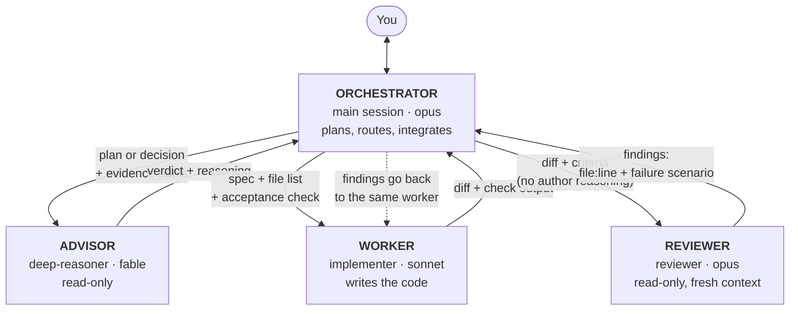

# claude-dispatch-kit

English | [繁體中文](README.zh-TW.md)

Working rules and skills for Claude Code: a four-seat dispatch model for
multi-agent work, plus three session skills for leaving the keyboard,
compacting mid-task, and closing out.

## How dispatch works

The main session never does bulk work itself. It hands each kind of work
to a dedicated subagent and keeps only conclusions in its own context.



### The four seats

| Seat | Does | Never does |
|---|---|---|
| **Orchestrator** (main session) | Talks to you, breaks the task down, writes the dispatch prompts, routes work, merges results, decides when it's done. Small things (one file, a grep, a short script) stay inline. | Bulk reading or mechanical edits across many files; implementing the first instance of a change; approving its own high-risk conclusions. |
| **Advisor** (`deep-reasoner`) | Reviews the plan of a large change before any code is written; gives the verdict on decisions you will act on (root cause, "safe to delete"); weighs direction changes and taste calls. **While you're away (afk), it stands in for you** on reversible decisions so work doesn't stall; each one is logged for you to keep or overturn when you return. | Writing or editing anything. It gets evidence paths and returns a verdict. Approving anything irreversible or outward (push, mail, deletes) — afk or not, those wait for you. |
| **Worker** (`implementer`) | Implements or refactors from a complete spec: an exact file list and an acceptance check it must run itself. | Touching files outside its list, drive-by fixes, planning, reviewing its own work. |
| **Reviewer** (`reviewer`) | Reviews the delivered diff in a fresh context against the acceptance criteria. Every finding needs `file:line` plus a concrete failure scenario. | Fixing anything. Findings go back to the worker who wrote the code. |

### A typical change

1. The orchestrator drafts a plan; the advisor reviews it once.
2. The worker implements it and runs the acceptance check.
3. The reviewer checks the diff; findings go back to the same worker.
4. Two failed rounds → the work moves up a model tier, carrying the full
   failure trail.
5. The orchestrator reports done only with evidence someone else produced
   (a test run, a review pass).

Split to remember: **plan → advisor, code → reviewer.**

## What's inside

| Path | What it does |
|---|---|
| `dispatch/core.md` | The dispatch rules. The main session orchestrates; an **advisor** reviews plans and gives verdicts; a **worker** implements from a complete spec and runs its own acceptance check; a **reviewer** in a fresh context reviews the delivered code. Also covers routing, escalation, and "never self-verify". About 2k tokens when loaded. |
| `dispatch/templates.md` | Prompt templates for dispatching each role (goal / acceptance / report). |
| `dispatch/seat-gate.sh` | Optional prompt hook: a one-line reminder each turn, only in repos that use the rules. |
| `agents/` | `deep-reasoner` (advisor, read-only), `implementer` (worker), `reviewer` (read-only reviewer). |
| `skills/afk` | Before you leave: collects every decision it needs from you, probes resources, lists what you owe, and agrees on what it will and won't touch. While you're away it keeps going: new decisions go to the advisor, anything irreversible is queued. When you return: a short digest, including every decision the advisor made for you. |
| `skills/pre-compact` | Mid-task: writes context-only state to disk, lists running jobs, and gives you a safe `/compact` argument. |
| `skills/wrap-up` | End of work: records outcomes and lessons, commits only this session's files, and lists what's still open. |

## Install

Clone the repo and let Claude Code install it:

```bash
git clone https://github.com/workfunction/claude-dispatch-kit.git
```

Then, in Claude Code:

> Read claude-dispatch-kit/INSTALL.md and install it.

It asks two questions (rules everywhere or per repo; reminder hook yes/no),
checks for name collisions before overwriting anything, and verifies the
result. To install by hand, follow the same file.

## Models

Defaults: main session `opus`, advisor `fable`, worker `sonnet`, reviewer
`opus`. Change them in one place: the §binding table in `dispatch/core.md`
plus the `model:` line of the matching agent file.

## Make it yours

The skills end with a Lessons section. When a step misleads you, Claude
adds a one-line lesson and fixes the step, so the skills adapt to your
workflow over time. Project-specific rules go in that repo's
`.claude/rules/`; they override `core.md` there.

## License

MIT
