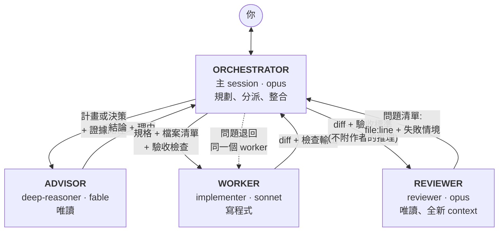

# cc-workflow-kit

[English](README.md) | 繁體中文

給 Claude Code 用的工作規則與 skill:一套多 agent 分工的四席位 dispatch
規則，加上三個 session skill,分別處理離開鍵盤、做到一半要 compact、
收工結案。

## Dispatch 怎麼運作

主 session 自己不做大量的工作。每一類工作交給專門的 subagent,自己的
context 只留結論。



### 四個席位

| 席位 | 負責 | 絕不做 |
|---|---|---|
| **Orchestrator**(主 session) | 跟你對話、拆解任務、寫派工 prompt、分派工作、整合結果、判斷何時算完成。小事(一個檔案、一次 grep、一支短 script)直接自己做。 | 大量閱讀或跨多檔的機械式修改;自己實作改動的第一個實例;自己核可高風險結論。 |
| **Advisor**(`deep-reasoner`) | 大型改動寫程式前審一次計畫;對你會據以行動的決定下結論(根因、「可以安全刪除」);評估方向轉換與取捨問題。**你離開時(afk)由它代替你做決定**,處理可逆的決策，讓工作不會卡住;每一筆都會記下來，你回來時決定保留或推翻。 | 寫或改任何東西。它拿到證據路徑，回傳結論。核可任何不可逆或對外的動作(push、寄信、刪除)——不管是不是 afk,這些都等你回來。 |
| **Worker**(`implementer`) | 依完整規格實作或重構：明確的檔案清單，加上它必須自己跑的驗收檢查。 | 動清單以外的檔案、順手修別的東西、做規劃、審自己的成果。 |
| **Reviewer**(`reviewer`) | 用全新的 context 對照驗收標準審查交付的 diff。每個問題都要附 `file:line` 和具體的失敗情境。 | 修任何東西。問題退回給寫程式的 worker。 |

### 一次典型的改動

1. Orchestrator 起草計畫,advisor 審一次。
2. Worker 實作並跑驗收檢查。
3. Reviewer 審 diff,問題退回同一個 worker。
4. 失敗兩輪 → 換更強的模型接手，並附上完整的失敗紀錄。
5. Orchestrator 只有在拿到別人產出的證據(測試結果、審查通過)時才回報完成。

一句話記住:**計畫 → advisor,程式 → reviewer。**

## 內容

| 路徑 | 用途 |
|---|---|
| `dispatch/core.md` | Dispatch 規則本體：席位、分派表、升級階梯、「絕不自己驗收自己」。載入後約 2k tokens。 |
| `dispatch/templates.md` | 派工給各角色的 prompt 範本(目標 / 驗收 / 回報格式)。 |
| `dispatch/seat-gate.sh` | 選用的 prompt hook:只在有啟用規則的 repo 裡，每輪加一行提醒。 |
| `agents/` | `deep-reasoner`(advisor,唯讀)、`implementer`(worker)、`reviewer`(唯讀審查)。 |
| `skills/afk` | 離開前：一次問完它需要你做的決定、檢查資源、列出你欠的事，並約定它會做和不會碰的範圍。你不在時它繼續做：新出現的決定交給 advisor,不可逆的動作先排進佇列。你回來時給一份簡短摘要，列出 advisor 替你做的每一個決定。 |
| `skills/pre-compact` | 做到一半：把只存在 context 裡的狀態寫進檔案、列出還在跑的工作，給你一段安全的 `/compact` 參數。 |
| `skills/wrap-up` | 收工：記錄結果與教訓、只 commit 這個 session 的檔案、列出還沒結的事。 |

## 安裝

Clone 這個 repo,讓 Claude Code 幫你裝:

```bash
git clone https://github.com/workfunction/cc-workflow-kit.git
```

然後在 Claude Code 裡說:

> 讀 cc-workflow-kit/INSTALL.md,照著安裝。

它會先問兩個問題(規則要全域生效還是只套用部分 repo;要不要裝提醒 hook),
覆蓋任何既有檔案前會先檢查同名衝突，最後自己驗證結果。想手動安裝，照同一份
檔案做即可。

## 模型

預設：主 session `opus`、advisor `fable`、worker `sonnet`、reviewer `opus`。
只要改一個地方:`dispatch/core.md` 的 §binding 表，加上對應 agent 檔的
`model:` 那一行。

## 調成你自己的

每個 skill 最後都有 Lessons 段落。某個步驟誤導了你,Claude 會補一行教訓並
修正那個步驟,skill 會慢慢貼近你的工作方式。專案專屬的規則放在該 repo 的
`.claude/rules/`,在那個 repo 裡會覆蓋 `core.md`。

## 授權

MIT
